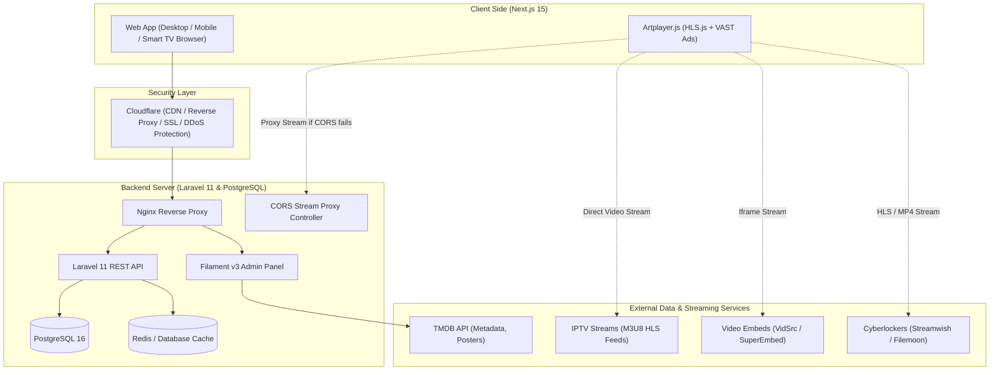
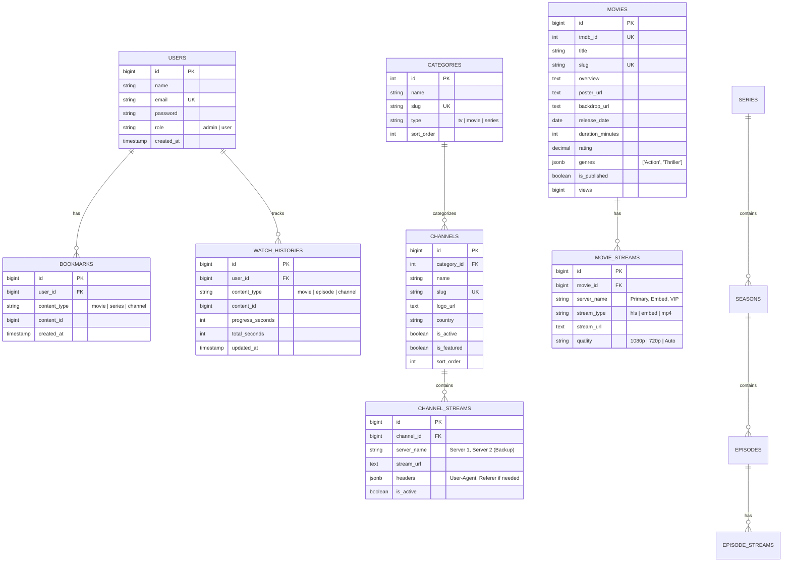
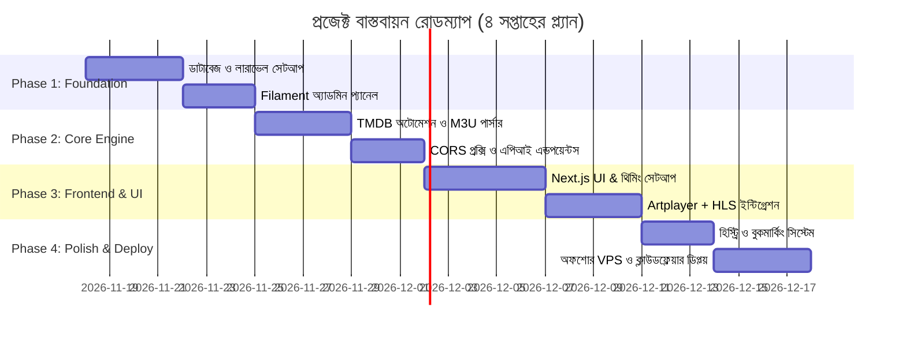

# 📋 Master Project Plan: Next-Gen Live TV & Movie Streaming Platform
**Tech Stack:** Next.js (Frontend) + Laravel 11 & Filament v3 (Backend & Admin) + PostgreSQL (Database) + Artplayer.js/HLS.js (Video Engine)  
**Architecture:** 100% Custom Headless (WordPress-Free)

---

## ১. প্রজেক্টের ভিশন ও মূল লক্ষ্য (Executive Summary)

এই প্রজেক্টের মূল উদ্দেশ্য হলো একটি প্রিমিয়াম ও আল্ট্রা-ফাস্ট স্ট্রিমিং প্ল্যাটফর্ম তৈরি করা যা একই সাথে **লাইভ টিভি (Live TV / BDIX IPTV)** এবং **মুভি/সিরিজ (VOD)** সার্ভিস প্রদান করবে। 

### মূল বৈশিষ্ট্যসমূহ:
* **জিরো স্টোরেজ খরচ (Zero Storage Cost):** নিজস্ব সার্ভারে কোনো ভিডিও ফাইল না রেখে ৩য় পক্ষের এমবেড এপিআই এবং ফ্রি সাইবারলকার ব্যবহারের মাধ্যমে চালানো।
* **অটোমেটেড কনটেন্ট ইমপোর্ট (1-Click TMDB Automation):** কোনো ম্যানুয়াল ডাটা এন্ট্রি ছাড়া ১-ক্লিকে মুভির পোস্টার, কাস্ট ও বিবরণ ইমপোর্ট।
* **বাফারলেস HLS প্লেয়ার (Artplayer + HLS.js):** লাইভ স্ট্রিম ও মুভি দ্রুত লোড হওয়ার জন্য কাস্টমাইজড প্লেয়ার।
* **মডার্ন অ্যাডমিন প্যানেল (Filament v3):** ওয়ার্ডপ্রেসের কোনো ঝামেলা ছাড়া দ্রুতগতির ড্যাশবোর্ড থেকে চ্যানেল, মুভি ও বিজ্ঞাপন নিয়ন্ত্রণ।

---

## ২. সামগ্রিক সিস্টেম আর্কিটেকচার (System Architecture)

---

## ৩. ডাটাবেজ আর্কিটেকচার (PostgreSQL Complete Schema)

PostgreSQL-এ রিলেশনাল মডেল ও ফ্লেক্সিবল JSONB ফিল্ডের মাধ্যমে স্কিমা তৈরি করা হয়েছে:

---

## ৪. ব্যাকএন্ড আর্কিটেকচার (Laravel 11 + Filament v3)

### ক. অ্যাডমিন প্যানেল ফিচারসমূহ (Filament v3):
1. **মুভি ইমপোর্টার (TMDB Automation):** 
   * অ্যাডমিন শুধু মুভির নাম বা TMDB ID ইনপুট দিলে লারাভেল স্বয়ংক্রিয়ভাবে ব্যানার, পোস্টার, রেটিং, ওভারভিউ এনে ডাটাবেজে স্টোর করবে।
2. **IPTV M3U প্লেলিস্ট পার্সার:** 
   * যেকোনো `.m3u` ফাইলের লিংক দিলে ব্যাকএন্ড স্বয়ংক্রিয়ভাবে সব চ্যানেল ও লোগো ফিল্টার করে ডাটাবেজে ড্রাফট বা লাইভ করে দেবে।
3. **মাল্টি-সার্ভার স্ট্রিম ম্যানেজার:**
   * প্রতিটি চ্যানেল ও মুভিতে ২-৪টি অল্টারনেটিভ সার্ভার লিংক যুক্ত করার সহজ ইউআই।
4. **অ্যাড প্লেসমেন্ট ম্যানেজার:**
   * হেডার, প্লেয়ারের নিচে বা পপ-আন্ডার অ্যাড কোড ডায়নামিকালি পরিবর্তন করার সুবিধা (কোড পরিবর্তন না করেই)।

### খ. কোর এপিআই মডিউলস (`/api/v1`):
* `GET /channels` & `GET /channels/{slug}`: লাইভ টিভি এবং ব্যাকআপ সার্ভার লোড।
* `GET /movies` & `GET /movies/{slug}`: ফিল্টারিং (জেনার, রেটিং, সাল), সার্চ ও স্ট্রিম সার্ভার।
* `GET /series`, `GET /series/{slug}`, `GET /episodes/{id}`: ওয়েব সিরিজের সিজন ও এপিসোড।
* `POST /user/history` & `GET /user/history`: কতদূর পর্যন্ত দেখা হয়েছে (Resume playback)।
* `GET /stream/cors-proxy?url=...`: ব্রাউজারের CORS ব্লক বাইপাস করার জন্য বিল্ট-ইন প্রক্সি।

---

## ৫. ফ্রন্টএন্ড আর্কিটেকচার (Next.js 15 App Router)

### ক. পেজ স্ট্রাকচার:
* **`/` (Home):**
  * হিরো ক্যারোসেল (Featured Movies / Live Events)।
  * "Continue Watching" সেকশন (ওয়াচ হিস্ট্রি থেকে)।
  * জনপ্রিয় লাইভ চ্যানেল গ্রিড।
  * ক্যাটাগরিভিত্তিক মুভি রো (Trending, Bangla, Hollywood, Anime)।
* **`/tv` & `/tv/[slug]` (Live TV):**
  * ফুলস্ক্রিন রেডি Artplayer।
  * চ্যানেল চেঞ্জার সাইডবার বা বটম স্লাইডার।
  * ব্যাকআপ সার্ভার সুইচ বাটন (যদি ১ নম্বর সার্ভার বাফার করে)।
* **`/movies` & `/movies/[slug]` (Movie Details & Player):**
  * ট্রেইলার ও মেটাডাটা।
  * সার্ভার সিলেকশন ট্যাব (Server 1: Fast HLS, Server 2: VidSrc Embed, Server 3: HD Download)।
  * রিলেটেড মুভি সাজেশন।
* **`/profile`:**
  * সেভ করা বুকমার্ক ও ওয়াচ হিস্ট্রি ম্যানেজমেন্ট।

### খ. প্লেয়ার কনফিগারেশন (Artplayer.js):
* **HLS Adaptive Bitrate:** ইন্টারনেটের স্পিড অনুযায়ী 1080p, 720p, 480p কোয়ালিটি অটো অ্যাডজাস্ট।
* **Resume Playback:** মুভি যেখানে পজ করা হয়েছিল, পরবর্তীতে সেখান থেকেই প্লে শুরু হবে।
* **Shortcuts:** স্পেস দিয়ে প্লে/পজ, অ্যারো কি দিয়ে ১০ সেকেন্ড ফরওয়ার্ড/রিওয়াইন্ড।
* **Mobile Friendly:** মোবাইল ফুলস্ক্রিন ও জেশ্চার সাপোর্ট।

---

## ৬. সার্ভার, ক্লাউড ও ডিপ্লয়মেন্ট প্ল্যান (Infrastructure)

কপিরাইট ও পারফরম্যান্স উভয় দিক সামলানোর জন্য সেরা সার্ভার সেটআপ:

| কম্পোনেন্ট | প্রযুক্তি | স্পেসিফিকেশন ও ভূমিকা |
| :--- | :--- | :--- |
| **সার্ভার OS** | Ubuntu 24.04 LTS | স্থিতিশীল ও দীর্ঘমেয়াদী সাপোর্ট |
| **হোস্টিং প্রোভাইডার** | BuyVM / AlexHost / Hetzner | Offshore/DMCA Ignored VPS ($7 - $15/month) |
| **ওয়েব সার্ভার** | Nginx | SSL টার্মিনেশন, রিভার্স প্রক্সি ও স্ট্যাটিক ক্যাশিং |
| **নোড রানটাইম** | Node.js 20+ & PM2 | Next.js অ্যাপ ২৪/৭ রানিং রাখার জন্য |
| **পিএইচপি রানটাইম** | PHP 8.3 FPM | Laravel 11 ও Filament অপ্টিমাইজড রানটাইম |
| **ডাটাবেজ** | PostgreSQL 16 | কনকারেন্ট রিড/রাইট অপ্টিমাইজড |
| **সিডিএন ও প্রটেকশন** | Cloudflare | ডিডস প্রটেকশন, ফ্রি SSL এবং অরিজিন আইপি হাইড করা |

---

## ৭. বাস্তবায়ন রোডম্যাপ ও সময়সীমা (Step-by-Step Implementation Timeline)

### ধাপ ১: ব্যাকএন্ড ও অ্যাডমিন প্যানেল তৈরি
* লারাভেল ১১ ও পোস্টগ্রেস ডাটাবেজ কানেকশন।
* ডাটাবেজ মাইগ্রেশন ও রিলেশনশিপ তৈরি।
* Filament v3 ইনস্টল করে মুভি ও লাইভ টিভি চ্যানেল ম্যানেজমেন্ট টেবিল তৈরি।

### ধাপ ২: এপিআই ও অটোমেশন তৈরি
* TMDB API ইন্টিগ্রেশন (১-ক্লিকে মুভির ডাটা নিয়ে আসা)।
* M3U8 CORS প্রক্সি কন্ট্রোলার তৈরি।
* ফ্রন্টএন্ডের জন্য সকল RESTful API এন্ডপয়েন্ট রেডি করা।

### ধাপ ৩: ফ্রন্টএন্ড ও ভিডিও প্লেয়ার ইঞ্জিন
* Next.js 15 App Router এবং Tailwind CSS দিয়ে ডার্ক-থিম (Netflix-স্টাইল) ইউআই তৈরি।
* Artplayer.js ও HLS.js এর কাস্টম প্লেয়ার কম্পোনেন্ট রেডি করা।
* লাইভ টিভি গ্রিড ও চ্যানেল সুইচিং লজিক।

### ধাপ ৪: টেস্টিং, নিরাপত্তা ও ডিপ্লয়মেন্ট
* মোবাইল ও ডেস্কটপ রেসপন্সিভনেস টেস্ট।
* অফশোর VPS-এ Nginx, PM2, PostgreSQL ও SSL কনফিগারেশন।
* ক্লাউডফ্লেয়ার ডিএনএস ও প্রক্সি সিকিউরিটি অ্যাক্টিভেশন।
